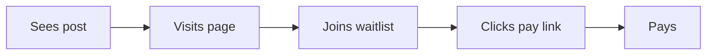

# Mermaid and docs.

Mermaid turns a few lines of plain text into a diagram: a flow, a timeline, a two-by-two. Claude Docs and Google Docs hold writing that people keep editing. Read this before drawing anything for Sean, and before deciding whether a piece of work should be a doc, a page or a diagram.

## What they're best at.

- **Mermaid: small diagrams that live as text.** The source sits in a markdown file, changes like any other text, and GitHub draws it on sight in files, issues and pull requests. Rebuilding one after a change takes seconds.
- **Claude Docs: writing Claude and Sean edit together.** A plan, a memo, a spec, meeting notes. Sean can comment on a paragraph and Claude answers in the thread. Its own diagrams are drawn so each label can be edited and each part commented on by name.
- **Google Docs: writing that travels.** Anything Sean will pass to other people, edit on his phone, or keep beside his other Google files.

Where something else beats them: anything Sean rules on goes on a house review page (the studio's review-pages guide), not a doc. Anything to click through, like a prototype, is a Claude artifact (`claude-artifacts.md`). A chart of real numbers is a chart, not a Mermaid diagram (see `sheets-and-python.md`).

## Setup.

- **Mermaid's renderer is installed:** `mmdc` 11.15.0, checked November 12, 2026. The newest command-line release on npm is 12.2.0; updating is Sean's call. Free. It draws in a hidden local browser, so nothing is uploaded.
- **The command that proves it works:**

```bash
mmdc --version && mmdc -i flow.mmd -o flow.svg
```

- **Claude Docs** works through its connector, already connected. **Google Docs** works through the Google Drive connector, also connected.

## Which diagram fits which question.

Pick the diagram from the question it answers, not from what looks impressive.

- **"What happens, in what order?"** A flowchart (`flowchart LR`). A signup path, a demand test from post to payment, how a decision gets made.
- **"Where does it sit against two things?"** A quadrant chart (`quadrantChart`). The natural picture for an assumption map: how much depends on a belief, against how much evidence backs it. The ones high on impact and low on evidence are what to test first.
- **"What does the person go through?"** A user journey (`journey`). Steps with a score for how each felt. Good after interviews, when the scores come from what people said, not from a guess.
- **"When does what happen?"** A timeline (`timeline`) for a sequence of milestones, a Gantt chart (`gantt`) when lengths and overlaps matter.
- **"What talks to what?"** A sequence diagram (`sequenceDiagram`). Rare in product work; useful when a payment link, a waitlist and an email tool hand data to each other.
- **"How do the ideas branch?"** A mind map (`mindmap`) for a first sort of a messy space. An opportunity tree (one outcome, the problems under it, the solutions under each) draws well as a top-down flowchart.

Skip pie charts and XY charts in Mermaid for real data. They're fine as sketches, but numbers belong in a chart built from the data, where the values can be checked.

## Getting the best out of it.

**Keep it small.** A diagram is read in one glance. About seven to twelve boxes is the useful range; past that, split it in two or move the detail to a table under it. If a diagram needs a paragraph to explain, it's the wrong diagram.

**Title it with the point.** "Most people drop off before the price" beats "Signup funnel". The reader gets the finding before reading a box.

**Words only from the work.** Every box label, number and step comes from the research or the plan. A diagram makes guesses look settled, so a guessed step gets marked as a guess, or left out.

**Short labels, plain words.** "Joins waitlist", not "User-initiated waitlist enrolment event". Two to four words a box.

**Render to SVG.** SVG stays sharp at any size and is small. `mmdc -i in.mmd -o out.svg` makes one; `-b transparent` drops the white background for a page with a dark theme; `-o out.png -s 2` makes a sharp PNG where an SVG won't go, such as a Google Doc. `mmdc` can also read a markdown file and draw every Mermaid block in it. Keep the `.mmd` source beside the picture, so the next change is a text edit, not a redraw.

**Check the render, not the source.** Look at the picture before showing it. Mermaid lays boxes out on its own, and a long label or one crossing line can turn a clear idea into a tangle. When that happens, shorten labels, flip direction (`LR` to `TB`), or split the diagram.

## When a doc beats a page.

The question is what the reader will do with it.

- **A doc** is for words people will keep editing, comment on, or pass around as text: a plan Sean will revise, interview notes, a one-page strategy memo, a brief for someone else. Claude Docs when Sean and Claude work on it together; Google Docs when it goes to other people or lives with his own files.
- **A page** (a Claude artifact) is for something to look at or use: a review page Sean rules on, a prototype, an explainer with a diagram at its heart, a result to be scanned rather than edited.
- **A markdown file in the repo** is for anything that's part of the studio's own knowledge, like this guide.

A sign of the wrong choice: a doc full of tables and pictures nobody edits wanted to be a page; a page Sean keeps asking to change in small wording ways wanted to be a doc.

## Where it goes wrong.

- **The diagram that tries to show everything.** Twenty boxes, crossing lines, a legend. Split it, or drop it and write three sentences.
- **Decoration.** A diagram that repeats the paragraph above it adds length, not understanding. Draw only when the shape tells something words don't: an order, a branch, a position.
- **Version mismatch.** Newer diagram types in Mermaid's documentation may not draw in the installed 11.15.0. Render locally before relying on one.
- **Different renderers draw differently.** GitHub, Claude Docs and `mmdc` each run their own copy of Mermaid. Check the picture where Sean will read it.
- **Special characters.** Brackets, quotes and colons inside labels can break the source. Wrap the label in double quotes.
- **A doc that should have been a decision.** A long memo that ends without saying what Sean needs to decide. Lead with the call, as the review pages do.
- **Losing the source.** An SVG with no `.mmd` beside it means redrawing from scratch next time.

## Examples.

A demand test, drawn small:



Five boxes, one direction, every step a thing that can be counted. Beside each box, the count from the test; under it, a sentence on where the biggest drop was. The weak version adds every page, email and edge case, and nobody can find the drop.

## Safety.

`mmdc` runs on the Mac and uploads nothing. Claude Docs are stored by Anthropic, Google Docs by Google; day-job material stays in Sean's private work repo, not in personal docs. Sharing a doc with anyone, or making it public, is Sean's call: ask first. Nothing here costs money.

## More details

- `mmdc --version` on this Mac, November 12, 2026: 11.15.0, at `/opt/homebrew/bin/mmdc`. Flowchart, quadrant chart, user journey and timeline each rendered to SVG here as a test. Newest `@mermaid-js/mermaid-cli` on npm the same day: 12.2.0.
- Flags from `mmdc --help`: `-i`, `-o` (svg, png, pdf or md), `-b` background colour, `-s` scale, `-t` theme, `-c` config file. Markdown input draws every Mermaid block.
- Diagram types: https://mermaid.js.org/intro/
- GitHub renders Mermaid in issues, discussions, pull requests, wikis and markdown files: https://docs.github.com/en/get-started/writing-on-github/working-with-advanced-formatting/creating-diagrams
- Claude Docs' diagram and Mermaid handling: the Claude Docs connector's own diagram guide, read November 12, 2026.
- House review pages: `craftwork/guides/review-pages.md`.
- Connectors working, per `productcraft/tools/choices.md`: Google Drive, Claude Docs.
