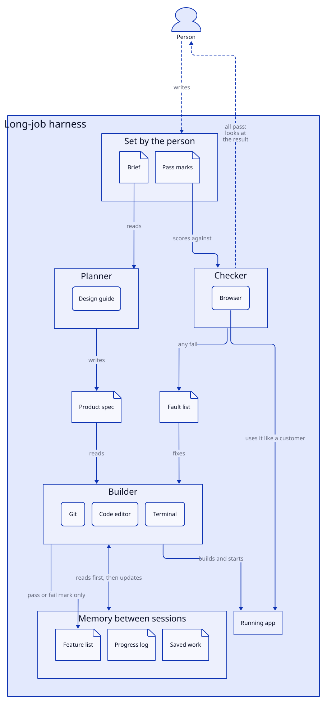

# D2: diagrams from a text file

This free tool turns a short text file into a diagram: boxes, boxes inside boxes, and arrows between them. Read this before drawing any system for Sean that is too big for a small sketch, because the drawing is how he sees a design.

## The same system, drawn both ways

The tool list picked D2 over Mermaid on a scout's reading, not a test. This is the test. The long-job harness from the public shelf (a planner, a builder and a separate checker) is drawn once in each tool, with the same 20 boxes, the same labels and the same 12 arrows.

| D2 0.9.0 | Mermaid 12.3.0 |
|---|---|
|  |  |

The sources: [the D2 file](pictures/long-job-harness.d2) and [the Mermaid file](pictures/long-job-harness.mmd).

What the test showed, on November 16, 2026:

- **D2 drew it cleanly.** The person sits on top, lines turn at right angles, every label sits on its line, and each group of boxes is snug.
- **Mermaid's answer depends on its version.** The newest, 12.3.0, drew the file nearly as cleanly as D2, in the same top-down order with square lines. An older one, 11.4.1, drew the very same file worse: the person pushed out to the left edge, one group stretched to about three times the height it needed, slanting lines, and a label running into a box. [That older picture is here](pictures/long-job-harness-mermaid-11.svg).
- **So the scout's reading holds only against older Mermaid.** At 20 boxes, today's Mermaid keeps up. Nothing here tests a system of 50.
- **The catch is which Mermaid does the drawing.** GitHub and Obsidian each carry their own copy, and which version each runs could not be confirmed. D2 gives the same picture wherever the file is drawn.

What still favours D2 for a bigger system: one command on the Mac with no browser, a grid for step-by-step boards, and a mistake that stops the run with its line number.

Whatever the test shows, Mermaid stays the better pick for a small diagram that lives inside a markdown file. GitHub and Obsidian draw Mermaid by themselves, with no tool. D2 always needs its picture drawn and saved beside the source.

## What it's best at

- **Boxes inside boxes.** An agent, its tools and its folders are written the way they nest. An arrow can end on a whole box or on a box inside it.
- **Step-by-step boards.** A grid sets numbered steps in rows, with no arrows to tangle.
- **Being redrawn by an agent.** The source is text, the harness drew in about a hundredth of a second, and a mistake stops the run with its line number.
- **Staying on the Mac.** No account, nothing uploaded.

Where another tool beats it: one design shown to Sean for a ruling goes on a house review page with simple drawn pictures. A small flow inside a markdown file is Mermaid's. A drawing Sean wants to drag around by hand is Excalidraw's.

## Setup

- **Installed:** D2 0.9.0, through Homebrew. Free and open source. No account, no key.
- **The command that proves it works,** from an empty folder:

```bash
printf 'planner -> builder -> checker\n' > proof.d2 && d2 proof.d2 proof.svg
```

It prints `success: successfully compiled proof.d2 to proof.svg` and the time taken.

- **The file ending picks the format.** `.svg` is the one to keep, because it stays sharp at any size. `.png` and `.pdf` also drew here, with the network blocked.
- **Trust the exit status, not the file.** D2's manual warns that a failed run can leave a half-drawn picture behind.

## Getting the best out of it

**Write the nesting as it is.**

```d2
builder: Builder {
  git: Git
}
spec: Product spec {shape: page}
spec -> builder: reads
builder.git -> spec: saves
```

The word before the colon is the box's short name. The words after it are what Sean reads. A dot reaches inside a box.

**Group boxes by where they sit in the flow.** The first draft of the harness put all seven files in one "Files on disk" box. Ten of its thirteen arrows crossed that box's edge. One engine sent arrows looping round the outside, and the other ran a line through a box. Splitting the files into two smaller boxes, with the two hand-off files loose between the agents, gave the clean picture above.

**Pick the layout engine on purpose.** A layout engine is the part that decides where the boxes go. Two come free: dagre, the default, and ELK. On the harness ELK won. Its lines turn at right angles, labels sit on their arrows, and box titles sit inside the box. Dagre drew curved lines that crossed, and set one label on top of another. Name the engine inside the file, so the plain command redraws the same picture:

```d2
vars: {
  d2-config: {
    layout-engine: elk
    pad: 20
  }
}
```

`pad` trims the margin from 100 pixels. A flag on the command line (`--layout dagre`) overrides the file.

A third engine, TALA, used to be a paid add-on. D2's notes for 0.9.0 say it is now free and built in, and `d2 layout` lists it here, but its old page still says paid. It has not been tried: ask Sean first.

**Use few shapes, each with one meaning.** In the harness: `person` for a person, `page` for a file, rounded corners for a tool, a plain box for the rest. A wrong shape name stops the run.

**Keep styling to named classes.** A class is a named set of looks, written once:

```d2
classes: {
  file: {shape: page}
  human: {style.stroke-dash: 3}
}
brief: Brief {class: file}
person -> brief: writes {class: human}
```

The harness uses three classes and no colours of its own. Dashed means "a person steps in", and the page beside the picture should say so.

**Step-by-step boards use a grid.**

```d2
board: One session, step by step {
  grid-rows: 2
  grid-columns: 4
  1: 1. Read the notes
  2: 2. Start the app
}
```

With `grid-rows` written first, cells fill across, the way a page is read. Put the step number in the label. Arrows inside a grid are straight lines from centre to centre, and a label on one doesn't fit in the gap.

**Sequence diagrams show who hands what to whom, in order.** Write `shape: sequence_diagram` on the first line, name the players, then one arrow for each hand-off. Top to bottom is the order of time.

**Themes.** `d2 themes` lists 20. Stay on the default. If a page needs otherwise, `-t 1` is a quiet grey, `--dark-theme 200` adds a version for dark mode, and `--sketch` looks hand-drawn.

**Read the picture, not the source.** Draw a PNG too (`d2 harness.d2 harness.png`) and look at it for crossing lines, labels on top of each other, and a box you didn't mean. A PNG comes out at twice the SVG's size; `--scale 0.5` halves it.

**Watch mode is for Sean at the screen.** `d2 --watch harness.d2 harness.svg` opens a live page and redraws on every save. Ctrl-C stops it. An agent working alone draws a PNG and reads that.

**Keep it to one glance.** The harness, at 20 boxes, is near the limit. Past that, draw the whole system with the insides left out, then one picture for each part. Tall beats wide, because a wide picture shrinks to nothing in a page column.

**Labels in plain words.** Two to four words a box, and a verb on every arrow: "writes", "scores against". D2 never wraps a long label, so break one with `\n`.

**The weaker design goes underneath.** Systemcraft's pages show the good design with the weaker one under it. Write `grid-columns: 1` on the first line, then two boxes: the good design, then the weak one with a class that makes it dashed and faded (`style.opacity: 0.6`).

**Turn an arrow round to straighten it.** The "all pass" arrow from the checker back to the person looped right round the picture. Written as `person <- harness.checker`, it runs straight, and the arrowhead still points at the person.

## Where it goes wrong

- **A grid fills the wrong way.** `grid-columns: 4` by itself put step 2 under step 1, not beside it. Write `grid-rows` first.
- **A typing slip makes a new box.** `harnes.planner` drew a stray box, and `d2 validate` still called the file valid. Count the boxes in the picture.
- **A dot in a name nests.** `v1.2: Version` drew a box inside a box called "v1". Put the name in double quotes. A `#` in a label starts a comment, so quote those too.
- **`direction` inside a box is ignored,** with no warning, unless the box is a cell of a grid.
- **Dagre refuses two things ELK allows:** an arrow from a box to something inside it, and a set width on a box that holds others.
- **The picture goes stale.** GitHub shows the saved picture, not the source. Redraw after every change.
- **An upgrade can move the boxes.** D2's notes for 0.8.2 say both engines changed and placements may shift. Redraw and re-read after any upgrade.

## Safety

- **D2 sends nothing out by itself.** SVG, PNG and PDF all drew with the network blocked, and no address for reporting use was found inside the program.
- **One exception: an icon named by a web address.** D2 fetches it while drawing. Use none, or a local file.
- **Never run `d2 play`,** and don't paste a design into the hosted playground. The command packs the whole file into the playground's page address, so its host receives it. The playground's own notes say it draws inside the browser and counts visits through an outside service. What else it keeps could not be confirmed.
- **Watch mode** listens on this Mac only.
- **What a picture carries:** the labels, D2's version number and its fonts. The harness picture was searched for folder paths and names and held none. D2's error messages do print the full folder path, so trim one before quoting it.
- **Cost:** nothing. **Ask Sean first** before using TALA, and before a drawing of his own systems goes into this public repo.

## More details

- **Checked November 16, 2026**, on this Mac: D2 0.9.0 (MPL-2.0 licence) at `/opt/homebrew/bin/d2`, against `d2 --help`, `man d2`, `d2 layout`, `d2 layout dagre`, `d2 layout elk` and `d2 themes`.
- **Run in a scratch folder:** every command and code block above; the harness in both free engines, top-down and left-to-right, in two groupings; grids; a sequence diagram; twelve shapes; themes 1 and 200; sketch; `d2 fmt`; `d2 validate`; watch mode with `--browser 0`, which listened on 127.0.0.1; SVG, PNG and PDF under a sandbox that denies the network.
- **The kept picture:** ELK, `pad: 20`, drawn with `d2 long-job-harness.d2 long-job-harness-d2.svg`. It blends the two posts' harnesses, as the shelf entry does. The posts name the planner's design guide, the builder's Git and the checker's browser; the code editor and terminal are assumed.
- **How the Mermaid pictures were drawn.** Mermaid's command-line tool is not on this Mac and nothing was installed. The lead opened a small local page in a browser, which loaded Mermaid's published library (11.4.1, then 12.3.0, the newest that day) and drew the file. Both pictures used the same file and Mermaid's default settings. Its file shape needs Mermaid 11.3.0 or newer. Mermaid's documents say version 12 lays flowcharts out with ELK by default and earlier versions with Dagre, which fits what the two pictures show.
- **One system, one test.** Twenty boxes, both tools given the same tidying. A harder first draft, with all seven files in one box, drew badly in both of D2's free engines before the files were split into two groups.
- **Not confirmed:** which Mermaid version GitHub and Obsidian run today. TALA's terms of use. GIF and PowerPoint output were not tried.
- **Sources, read November 16, 2026:** D2's tour (https://d2lang.com/tour/layouts, https://d2lang.com/tour/grid-diagrams, https://d2lang.com/tour/exports, https://d2lang.com/tour/vars); release notes (https://github.com/d2lang/d2/releases); the source of `d2 play` (https://github.com/d2lang/d2/blob/v0.9.0/d2cli/play.go); the playground's notes (https://github.com/terrastruct/d2-playground); TALA's old page (https://github.com/terrastruct/TALA); Mermaid's flowchart document (https://mermaid.js.org/syntax/flowchart.html); GitHub on diagrams (https://docs.github.com/en/get-started/writing-on-github/working-with-advanced-formatting/creating-diagrams); Obsidian's help (https://obsidian.md/help/advanced-syntax).
